<div align="center">

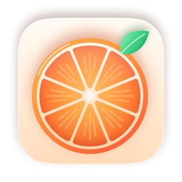

# Clementine

**Convert any file by dragging it. Right where it is.**

Hold <kbd>⇧</kbd> while you drag a file and a wheel of formats opens under your pointer.<br>
Drop on one, and the new file appears next to the original. Nothing leaves your Mac.

[](https://github.com/mustafahalabi/clementine/releases/latest)
[](#system-requirements)
[](#system-requirements)
[](#install)

<a href="https://github.com/mustafahalabi/clementine/releases/latest"></a>

<sub>Free download · Signed &amp; notarized by Apple · Updates itself</sub>

<br><br>

<picture>
  <source media="(prefers-color-scheme: dark)" srcset="docs/images/hero-dark.webp">
  <source media="(prefers-color-scheme: light)" srcset="docs/images/hero-light.webp">
  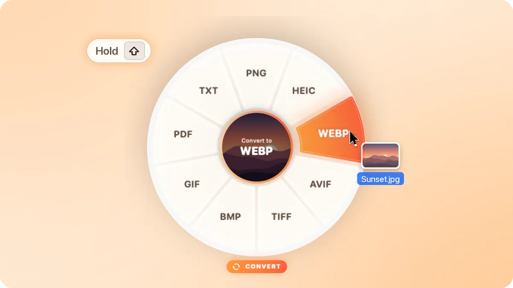
</picture>

</div>

<div align="center">

<a href="https://mustafahalabi.github.io/clementine/">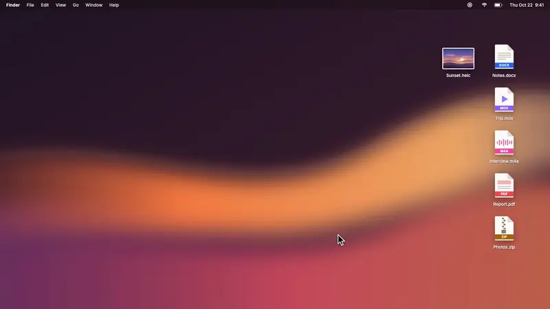</a>

<sub>▶ <a href="https://mustafahalabi.github.io/clementine/"><b>Watch the 65-second launch film</b></a></sub>

</div>

<br>

## Everything stays on your Mac

Clementine is a small menu bar app that turns file conversion into a gesture. There's no website to upload to, no
window to open, no "Save As…" dialog to fill in. Every conversion runs on your Mac with the system's own frameworks
and a bundled copy of ffmpeg. Your files never go anywhere.

<table>
<tr>
<td width="33%" valign="top">

**Private by design**<br>
Nothing is uploaded, ever. No account, no tracking, no network needed to convert.

</td>
<td width="33%" valign="top">

**Right next to the original**<br>
The new file lands in the same folder. The original is never touched or overwritten.

</td>
<td width="33%" valign="top">

**Fast in batches**<br>
Drop a whole selection. Clementine works on several files at once and shows progress for each job.

</td>
</tr>
</table>

## How it works

<table>
<tr>
<td width="33%" valign="top" align="center">
<picture>
  <source media="(prefers-color-scheme: dark)" srcset="docs/images/step-1-dark.png">
  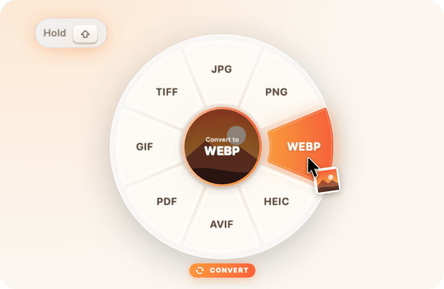
</picture>
<br><b>1 · Drag with <kbd>⇧</kbd></b><br>
<sub>Start dragging any file from Finder or the desktop, then hold Shift. The convert wheel opens under the pointer.</sub>
</td>
<td width="33%" valign="top" align="center">
<picture>
  <source media="(prefers-color-scheme: dark)" srcset="docs/images/step-2-dark.png">
  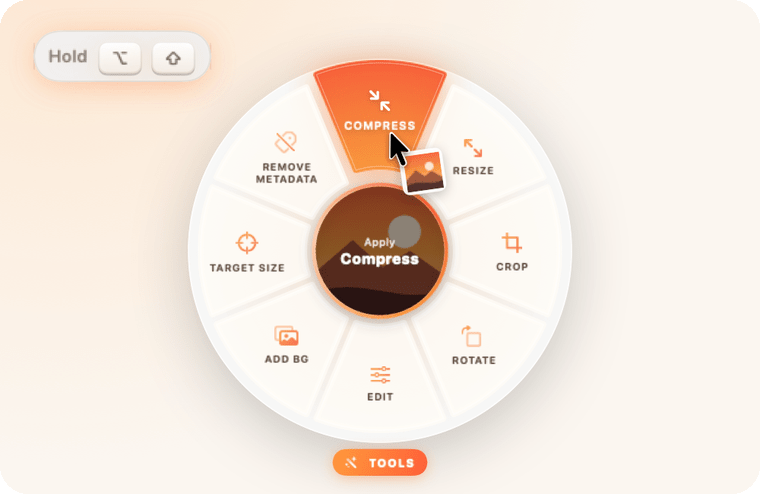
</picture>
<br><b>2 · Or <kbd>⌥</kbd><kbd>⇧</kbd> for tools</b><br>
<sub>Hold Option too and the wheel fills with tools for that kind of file: compress, resize, trim, merge and more.</sub>
</td>
<td width="33%" valign="top" align="center">
<picture>
  <source media="(prefers-color-scheme: dark)" srcset="docs/images/step-3-dark.png">
  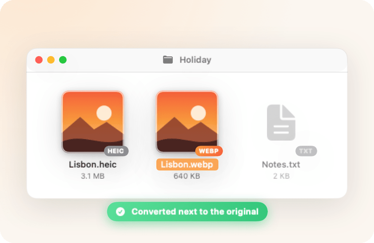
</picture>
<br><b>3 · Drop. Done.</b><br>
<sub>Let go over a slice. The result appears beside the original. Drop on the middle of the wheel to cancel.</sub>
</td>
</tr>
</table>

## One wheel for every kind of file

The wheel only shows what makes sense for the file you're holding, and the slices you use most move to the front.

<p align="center">
<picture>
  <source media="(prefers-color-scheme: dark)" srcset="docs/images/wheels-dark.png">
  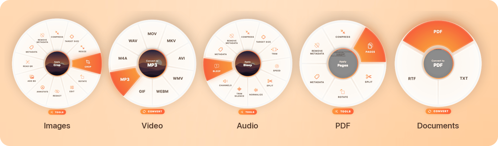
</picture>
</p>

| Drop | Convert to (<kbd>⇧</kbd>) |
| --- | --- |
| **Images** (incl. HEIC, WebP, SVG, AVIF) | JPG, PNG, HEIC, WebP, AVIF, TIFF, BMP, GIF, PDF, TXT (text recognition); animated GIF → MP4 |
| **Video** | MP4, MOV, MKV, AVI, WMV, WebM, GIF, and the soundtrack as MP3 / M4A / WAV |
| **Audio** | MP3, M4A, WAV, FLAC, OGG, Opus, AIFF |
| **Documents** (DOCX, DOC, RTF, TXT, HTML, ODT, MD) | PDF, DOCX, TXT, RTF |
| **PDF** | TXT, DOCX, PNG / JPG pages |
| **Subtitles** | SRT ⇄ VTT |
| **Archives** (ZIP, TAR, GZ, RAR, 7Z…) | Extract, or repack as ZIP / TAR / GZIP |
| **Folders, other files, mixed selections** | ZIP, TAR, GZIP |

### Images

<picture>
  <source media="(prefers-color-scheme: dark)" srcset="docs/images/type-images-dark.png">
  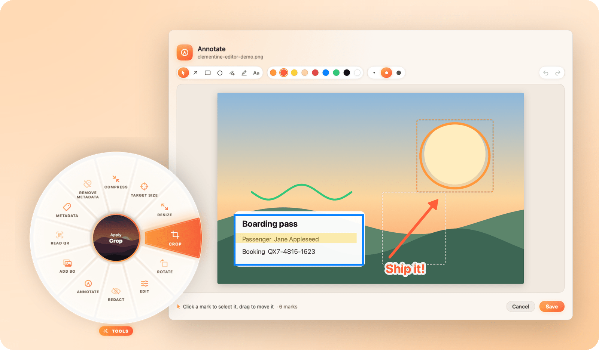
</picture>

**Compress**, hit a **Target Size**, **Resize**, **Crop**, **Rotate/Flip**, and **Edit** exposure, brightness,
contrast, saturation, highlights and shadows with a live preview. **Redact** faces and text, **Annotate** with arrows,
shapes and text, **Cut Out Subject** (removes the background and leaves the person, pet or object on transparency,
on-device with Apple's Vision), **Add BG** (a gradient backdrop with padding, rounded corners and a shadow), **Read QR** codes, and view, edit or remove **Metadata**
(including location). Drop two or more images to make a **Collage** or a **PDF**.

### Video

<picture>
  <source media="(prefers-color-scheme: dark)" srcset="docs/images/type-video-dark.png">
  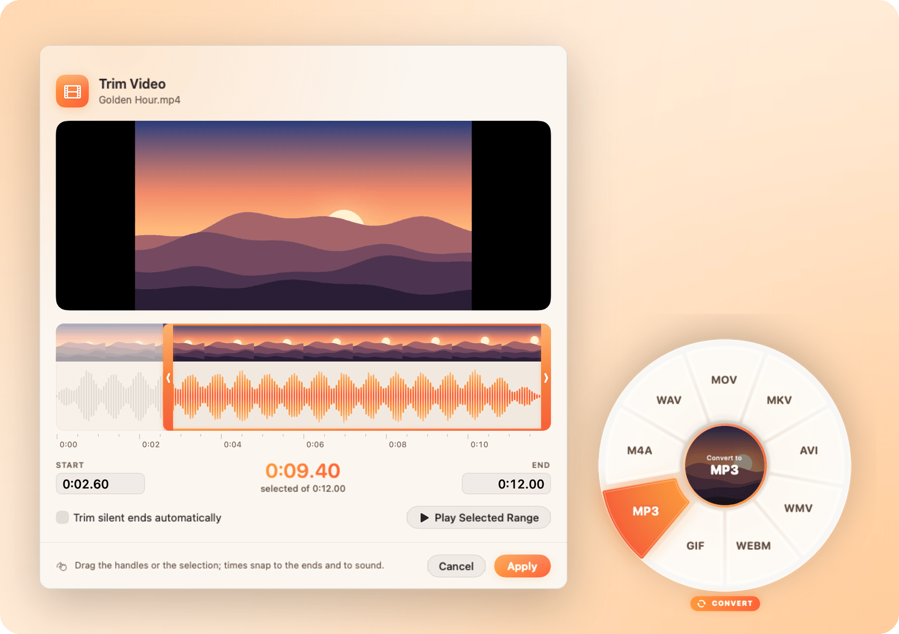
</picture>

**Trim** on a filmstrip and waveform, **Compress** or hit a **Target Size** (two-pass), change **Speed**, **Split**,
take a **Snapshot**, **Mute**, **Rotate**, **Bleep** words out, and edit or remove **Metadata**. Drop two or more
clips to **Join** them.

### Audio

<picture>
  <source media="(prefers-color-scheme: dark)" srcset="docs/images/type-audio-dark.png">
  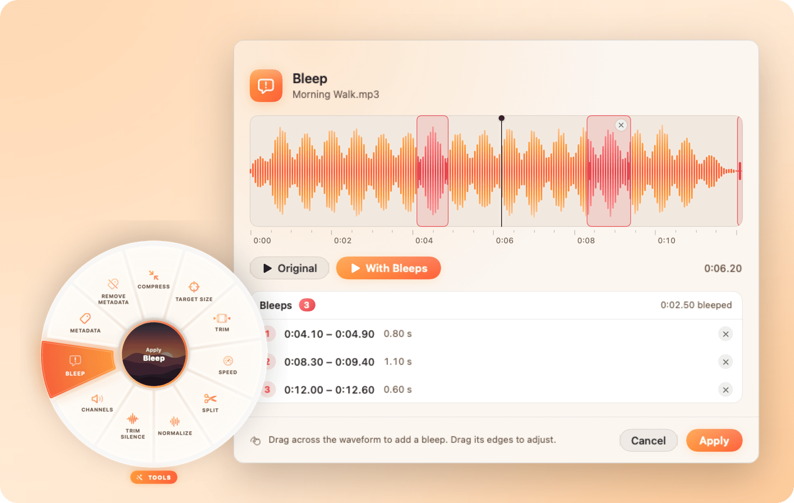
</picture>

**Trim** with a waveform editor that can trim silent ends for you, **Bleep** regions you drag on the waveform (and
preview them), fix **Channels** (mono, stereo, or swap left and right with a volume for each side), **Normalize**
loudness (EBU R128), **Trim Silence**, change **Speed**, **Split**, **Compress**, hit a **Target Size**, and edit or
remove **Metadata**. Drop two or more files to **Join** them.

### PDF

<picture>
  <source media="(prefers-color-scheme: dark)" srcset="docs/images/type-pdf-dark.png">
  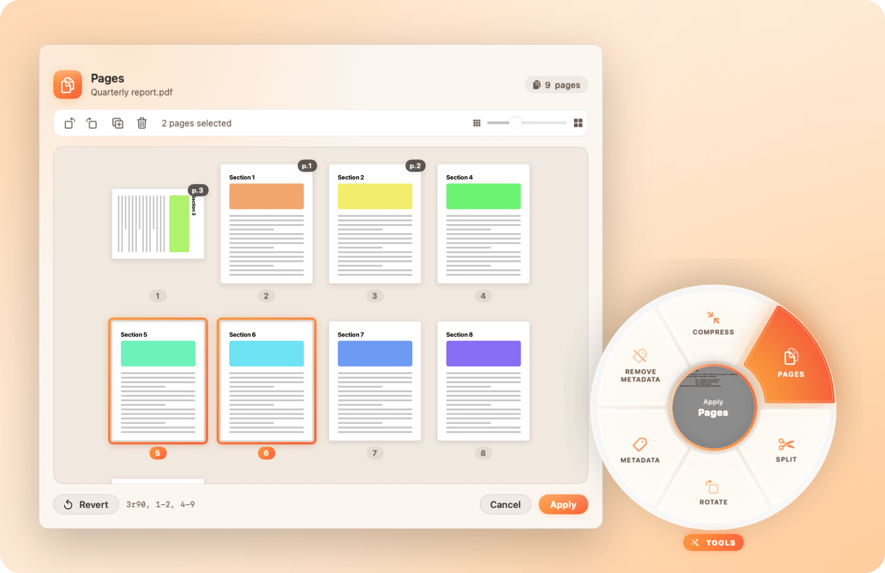
</picture>

Organize **Pages** in a thumbnail grid: drag to reorder, rotate, duplicate, delete. **Compress**, **Split**,
**Rotate**, and edit or remove **Metadata**. Drop two or more PDFs to **Merge** them in the same page grid.

## Editors that feel at home

Tools that need your eye open a focused editor. **Return** applies, **Esc** cancels, **Delete** removes the
selection. Metadata edits are saved to an `(edited)` copy without re-encoding.

<p align="center">
<picture>
  <source media="(prefers-color-scheme: dark)" srcset="docs/images/editor-crop-dark.png">
  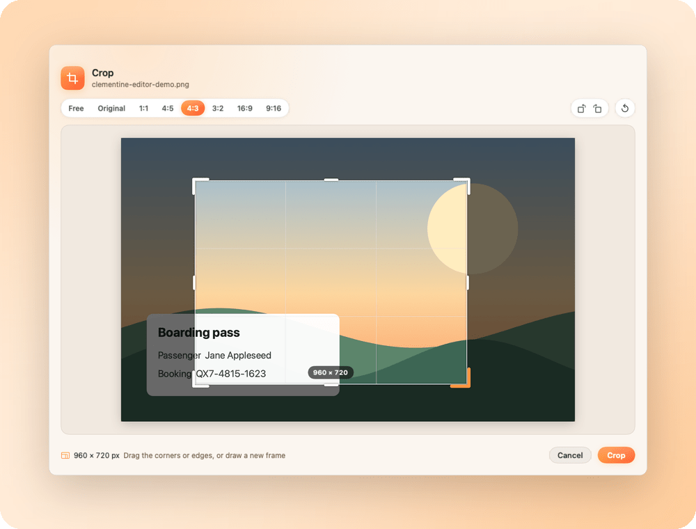
</picture>
<picture>
  <source media="(prefers-color-scheme: dark)" srcset="docs/images/editor-redact-dark.png">
  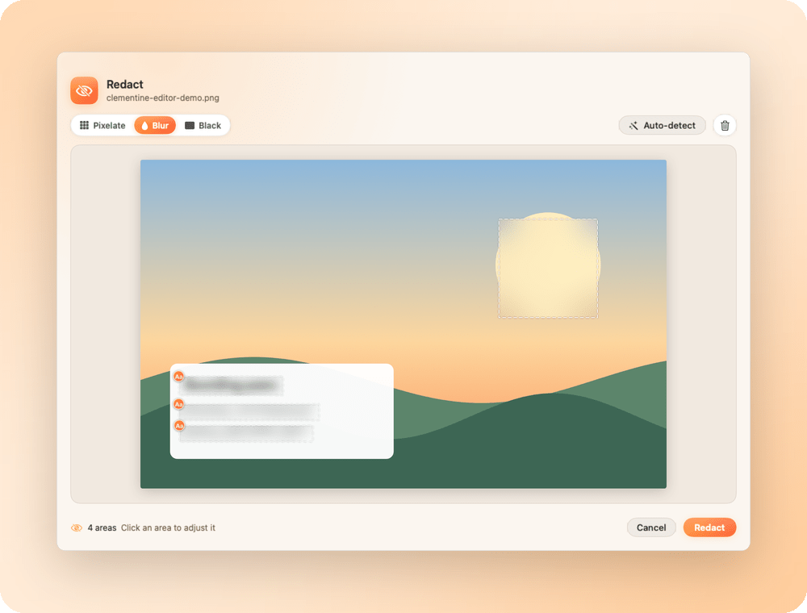
</picture>
</p>

<table>
<tr>
<td width="50%" valign="top"><b>Crop</b><br><sub>Drag the frame's corners and edges, pick an aspect (Free, Original, 1:1, 4:5, 4:3, 3:2, 16:9, 9:16), turn in 90° steps.</sub></td>
<td width="50%" valign="top"><b>Redact</b><br><sub>Cover areas you draw, or faces and lines of text found with Auto-detect, using pixelate, blur or solid black. The original pixels are destroyed, not hidden.</sub></td>
</tr>
</table>

<p align="center">
<picture>
  <source media="(prefers-color-scheme: dark)" srcset="docs/images/editor-trim-audio-dark.png">
  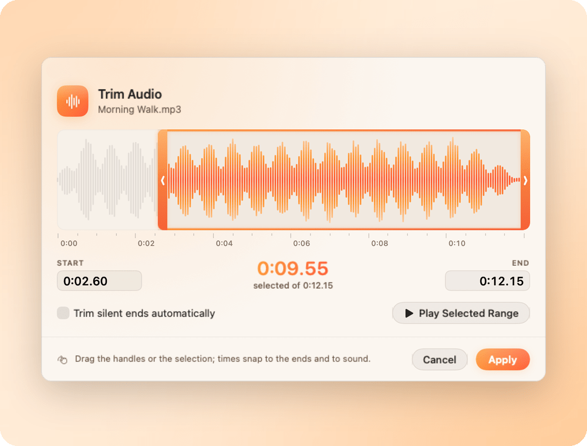
</picture>
<picture>
  <source media="(prefers-color-scheme: dark)" srcset="docs/images/editor-channels-dark.png">
  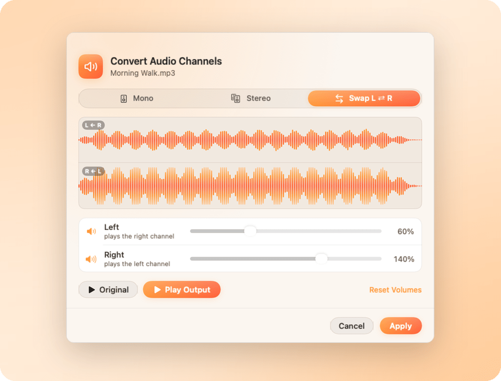
</picture>
</p>

<table>
<tr>
<td width="50%" valign="top"><b>Trim</b><br><sub>Drag the handles or the selection; times snap to the ends and to sound. Play the selected range before you apply.</sub></td>
<td width="50%" valign="top"><b>Channels</b><br><sub>Mono, stereo, or swap L ⇄ R, with a volume for each side. Play the original or the output to compare.</sub></td>
</tr>
</table>

<p align="center">
<picture>
  <source media="(prefers-color-scheme: dark)" srcset="docs/images/editor-merge-dark.png">
  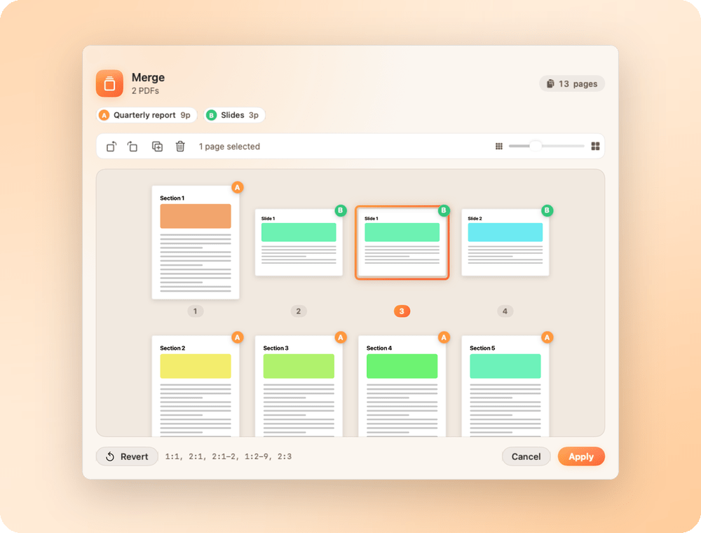
</picture>
<picture>
  <source media="(prefers-color-scheme: dark)" srcset="docs/images/editor-edit-metadata-dark.png">
  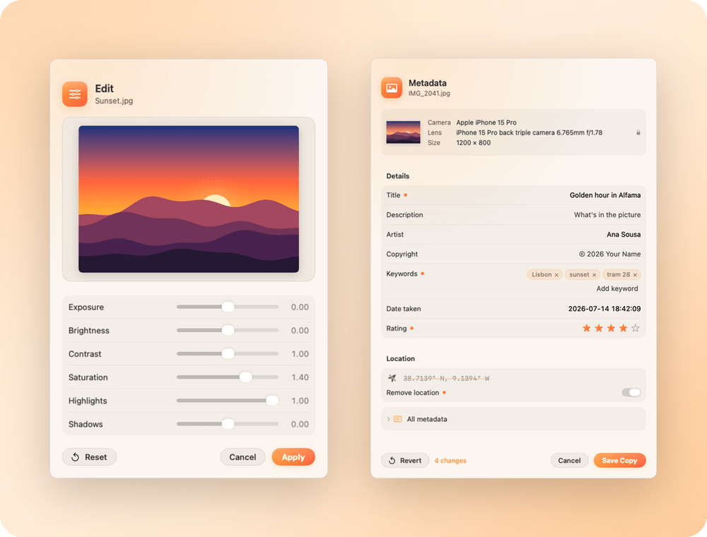
</picture>
</p>

<table>
<tr>
<td width="50%" valign="top"><b>Merge</b><br><sub>Every page from every PDF in one grid, marked by source file. Reorder, rotate, duplicate or drop pages before merging.</sub></td>
<td width="50%" valign="top"><b>Edit and Metadata</b><br><sub>Tune an image with a live preview. Read and edit titles, keywords, ratings, dates and location, or strip them all.</sub></td>
</tr>
</table>

The **Annotate**, **Bleep** and **Pages** editors are shown in the sections above.

## Power features

<table>
<tr>
<td width="50%" valign="top">
<picture>
  <source media="(prefers-color-scheme: dark)" srcset="docs/images/click-mode-dark.png">
  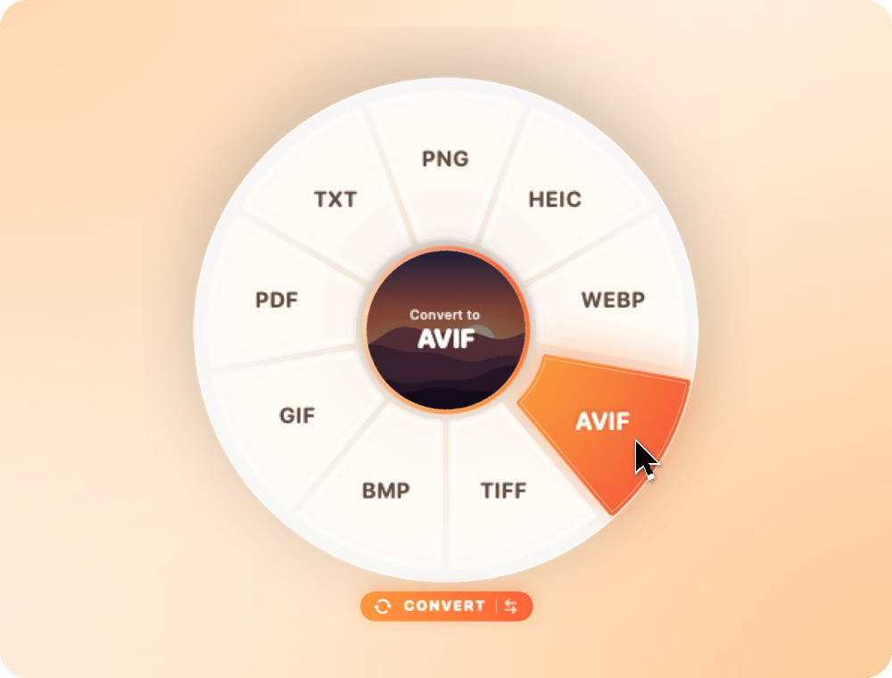
</picture>

**No drag needed.** Right-click files in Finder › Services › **Convert with Clementine** or **Clementine Tools**,
or choose **Open Files…** in the menu bar. The wheel opens in click mode: hover and click a slice, press
<kbd>Tab</kbd> (or click the chip) to switch wheels, use the arrow keys and <kbd>Return</kbd>, and close it with
<kbd>Esc</kbd> or a click outside.

</td>
<td width="50%" valign="top">
<picture>
  <source media="(prefers-color-scheme: dark)" srcset="docs/images/undo-dark.png">
  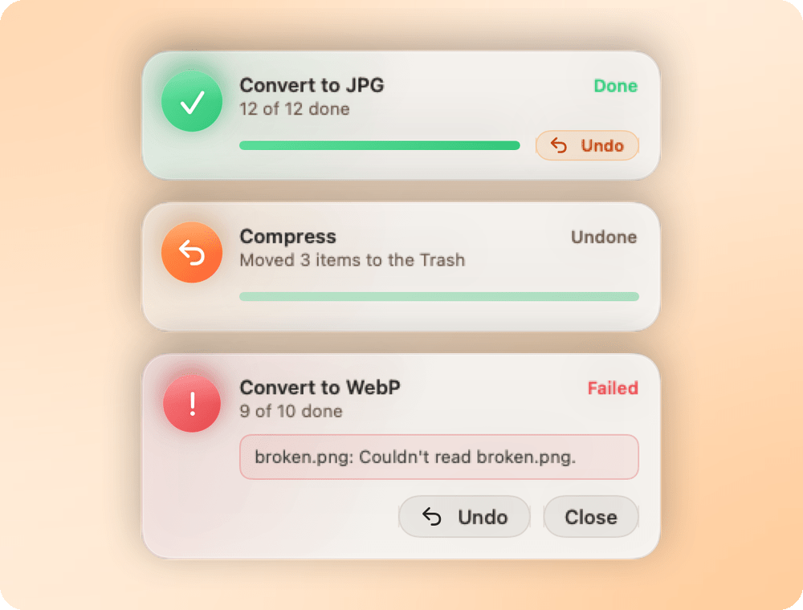
</picture>

**History and undo.** Each finished job offers **Undo** for a few seconds (hover to keep it open). The menu bar's
**Recent** submenu lists the last jobs (click one to reveal its files), and **Undo Last Conversion** moves the
newest job's files to the Trash. The last 50 jobs are kept.

</td>
</tr>
<tr>
<td width="50%" valign="top">
<picture>
  <source media="(prefers-color-scheme: dark)" srcset="docs/images/settings-wheel-dark.png">
  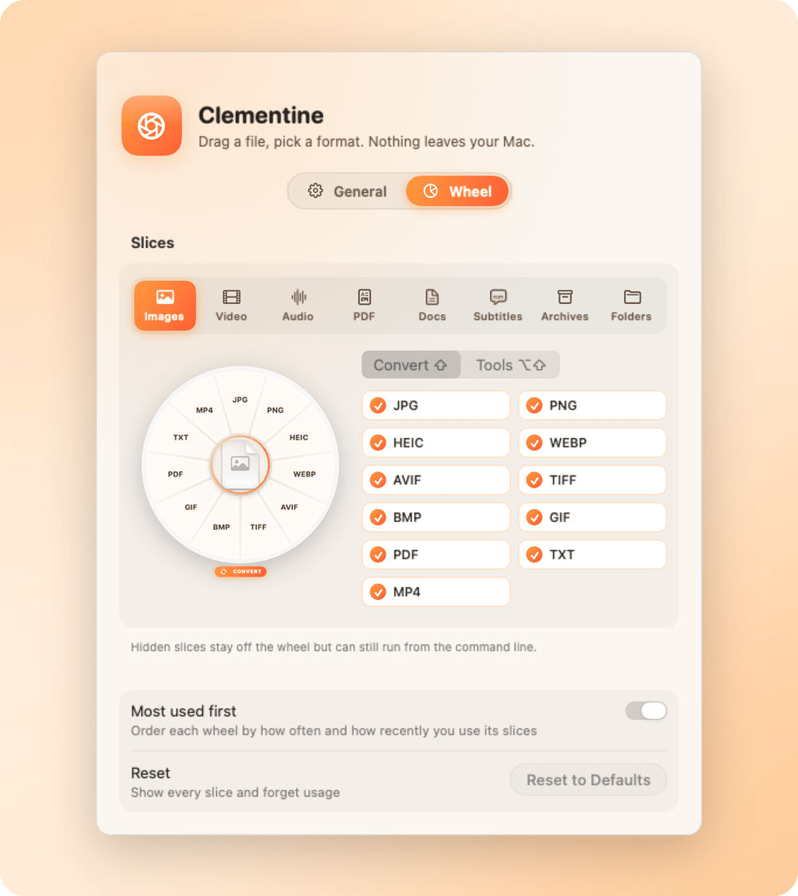
</picture>

**Your wheel, your way.** Slices you use most move to the front, per kind of file and per wheel (uses fade with a
two-week half-life). Settings › Wheel hides slices you never use, with a live preview, and resets everything.

</td>
<td width="50%" valign="top">

**Batches.** Drop many files at once. Clementine runs the action on each of them, several in parallel (up to half
your cores for images and documents, two at a time for audio and video), or once on all of them for Join, Merge,
Collage and Make PDF. Each job gets a small progress card with cancel, and finished files are revealed in Finder.

**Switch mid-drag.** Press or release <kbd>⌥</kbd> while the wheel is open to flip between the convert and tools
wheels.

**A command line, too.** Every action on the wheel also runs from Terminal with the same engine, so you can script
it. See [For developers](#for-developers).

**Shortcuts.** Clementine's actions are in the Shortcuts app too. See [Shortcuts](#shortcuts).

**Settings.** Turn the wheel off while dragging, choose whether finished files are revealed in Finder, launch at
login, set JPEG/HEIC quality, and point Clementine at an extra folder of command-line tools.

</td>
</tr>
</table>

## Shortcuts

Clementine adds three actions to the Shortcuts app (search for "Clementine" in the action list):

| Action | What it does |
| --- | --- |
| **Convert with Clementine** | Runs any conversion or tool on the files you pass it. Pick the action from a list; once the shortcut has files, the list shows only what fits them, like the wheel. **Settings** (optional) takes `key=value` lines, the same as the command line's `--set` (for example `level=Smallest` for Compress). |
| **Remove Background with Clementine** | Cuts the subject out of images onto transparency. Choose PNG, HEIC or WebP, and whether to crop to the subject. |
| **Convert Images with Clementine** | Converts images to JPG, PNG, HEIC, WebP, AVIF, TIFF, GIF or PDF. Images already in that format pass through. |

Each returns the new files, so the next step of the shortcut can use them. As with the wheel, results are saved next
to the originals. Files without a place on disk (an image from the clipboard, say) are worked on in a temporary
folder, so save the results somewhere if you want to keep them. Clementine doesn't need to be running: Shortcuts
starts it in the background and the action runs without opening a window. Shortcuts runs don't appear in History.

The action ids and settings for **Convert with Clementine** are the ones in [docs/CLI.md](docs/CLI.md).

## Install

1. **[Download the latest `Clementine-<version>.dmg`](https://github.com/mustafahalabi/clementine/releases/latest)**
   from GitHub Releases.
2. Open it and drag **Clementine** into **Applications**.
3. Open Clementine from Applications. It's signed and notarized by Apple, so macOS opens it after the usual
   "downloaded from the internet" confirmation.
4. A short **welcome tour** shows the two gestures. Clementine then lives in the menu bar, where
   **Show Welcome…** reopens the tour any time.

<details>
<summary><b>Good to know</b></summary>

- **Keep it in `/Applications`.** The right-click **Services** entries (Convert with Clementine, Clementine Tools)
  appear once the app lives there.
- **No setup, no extra downloads.** ffmpeg and the WebP tools are built in.
- **No special permissions.** Clementine notices drags by watching for mouse-downs and the system drag pasteboard,
  which doesn't need Accessibility access.
- **Updates** come through Sparkle: menu bar › **Check for Updates…**.
- **Launch at login** is a switch on the last page of the welcome tour and in Settings.

</details>

### System requirements

- **macOS** 14 Sonoma or later
- **A Mac with Apple silicon** (M1 or later)
- **About 68 MB** to download (the DMG, ffmpeg included)

Releases so far are built for Apple silicon only. Intel Macs can build a universal app from source with
`UNIVERSAL=1` (see [For developers](#for-developers)); it adds about 320 MB of tools.

## FAQ

<details>
<summary><b>Does Clementine upload my files anywhere?</b></summary>
<br>
No. Every conversion runs locally with macOS frameworks (ImageIO, Core Image, Vision, PDFKit, AVFoundation, the
AppKit text system) and bundled command-line tools (ffmpeg, ffprobe, cwebp, img2webp). The only network request
the app makes on its own is Sparkle's check for updates.
</details>

<details>
<summary><b>Is it free?</b></summary>
<br>
Yes. Download it from GitHub Releases at no cost.
</details>

<details>
<summary><b>Will it overwrite my files?</b></summary>
<br>
No. Results are written next to the original under a new name, never over an existing file. If a job fails or you
cancel it, nothing is left behind. Undo moves a job's new files to the Trash.
</details>

<details>
<summary><b>Does it run on Intel Macs?</b></summary>
<br>
The published releases are Apple silicon only. The project can build a universal (Intel + Apple silicon) app with
<code>UNIVERSAL=1</code>, but that isn't what's on the Releases page.
</details>

<details>
<summary><b>Why isn't it on the Mac App Store?</b></summary>
<br>
App Store apps must run in the App Sandbox. Clementine needs to see file drags anywhere on screen and to run ffmpeg
as a separate process, and the sandbox allows neither. So it's distributed directly, signed with a Developer ID and
notarized by Apple.
</details>

<details>
<summary><b>The wheel doesn't appear when I drag.</b></summary>
<br>
Start the drag first, then press <kbd>⇧</kbd> (or <kbd>⌥</kbd><kbd>⇧</kbd>). Check that "Show the wheel while
dragging" is on in Settings and that Clementine is running (look for it in the menu bar).
</details>

## Known limits

- **Metadata editing** covers the common fields. WebP, GIF, AVIF and other formats that can't be edited without
  re-encoding open read-only.
- **Waveform editors** show a filmstrip and video preview only for formats AVFoundation reads (MP4, MOV, M4V); MKV,
  WebM and the like get the waveform and sound-only playback. Bleep and Channels previews are rendered with ffmpeg
  first, so long files take a moment.
- **Split** copies streams without re-encoding, so cuts land on keyframes and part lengths are approximate.
- **DOCX → PDF** keeps text styling but not embedded images.
- **RAR** can be extracted but not created.
- **Cut Out Subject** uses the same model as Photos' "Copy Subject": it finds people, pets and distinct objects, not
  arbitrary regions, and keeps every subject it finds. Without a clear subject it says so instead of guessing.
- **Open Files…** shows the standard open panel while another app is still active; click into it before typing.

## Contributing

Bug reports, format requests and pull requests are welcome. `main` is protected: fork the repo, open a pull request,
and it's merged after CI passes and [@mustafahalabi](https://github.com/mustafahalabi) reviews and approves it. Read
[CONTRIBUTING.md](CONTRIBUTING.md) first; for anything bigger than a small fix, open an issue to agree on the
approach.

## License

Clementine's own code has **no open-source license**. It's public to read, but all rights are reserved.

Release builds bundle FFmpeg (static GPL v3 builds by [Martin Riedl](https://ffmpeg.martin-riedl.de), run as
separate processes), Google's libwebp tools (BSD) and [Sparkle](https://sparkle-project.org) (MIT). Versions,
source locations and how to swap in an LGPL FFmpeg are in [THIRD_PARTY_NOTICES.md](THIRD_PARTY_NOTICES.md).

## For developers

**Docs:** [Architecture](docs/ARCHITECTURE.md) · [CLI & action catalog](docs/CLI.md) · [Testing](docs/TESTING.md) ·
[Releasing](RELEASING.md) · [Changelog](CHANGELOG.md) · [Agent & contributor guide](AGENTS.md) ·
[Third-party notices](THIRD_PARTY_NOTICES.md)

### Build and test

Requires macOS 14+ and Xcode 16+ (Swift 6 toolchain). Swift Package Manager fetches
[Sparkle](https://sparkle-project.org) on the first build. You can also open `Package.swift` in Xcode.

```sh
make tools                   # optional: verified static ffmpeg/ffprobe + cwebp/img2webp into vendor/bin, bundled into the app
make run                     # builds build/Clementine.app and launches it
make install                 # copies it to /Applications
make test                    # all eight headless suites (every action on generated files), summary at the end
make ui-test                 # interaction tests: real windows off-screen, driven with synthetic clicks, drags and typing
scripts/test-waveform.sh     # channel layouts, bleeps on video, editor times, offscreen editor renders
scripts/test-pdf-metadata.sh # page lists, merge picks and metadata writers, read back after each run
scripts/test-image-editor.sh # crop / redact / annotate engines, from the JSON the editors produce
```

An app built without `make tools` uses Homebrew's tools (`brew install ffmpeg webp`); the test suites use
`vendor/bin` when `make tools` has run. External tools are looked up in the folder set in Settings first (so you can
use your own ffmpeg build), then the app's `Contents/Resources/bin`, then `/opt/homebrew/bin`, `/usr/local/bin`,
`/usr/bin` and `/bin`. CI (`.github/workflows/ci.yml`) runs all eight suites against the bundled ffmpeg plus a
release build on every push and pull request.

### Command line

Every wheel action also runs from the command line, which is how the test suites work:

```sh
BIN=.build/debug/Clementine
$BIN --list photo.heic                                   # the wheels for this file, as they'd appear
$BIN --run convert.image.webp photo.heic                 # run one action
$BIN --run tool.fit --set megabytes=2 clip.mov           # with parameters
$BIN --run tool.image.crop --set 'crop={"x":0,"y":0,"w":800,"h":600}' photo.jpg   # editors take JSON
```

[docs/CLI.md](docs/CLI.md) has every flag, every action id with its parameters, and the debug-only modes
(`--render-ui`, `--render-wheel`, `--demo-wheel`, `--ui-test`) that also produced the screenshots on this page.

### How it's built

```
Sources/Clementine/
  App/          entry point, menu bar, settings, CLI, Shortcuts actions (App Intents), welcome tour, Sparkle updater
  Drag/         DragMonitor (spots file drags + modifier keys), WheelController (glue)
  Wheel/        WheelPanel (floating drop target), WheelView (SwiftUI), WheelModel (geometry, hit-testing)
  Actions/      Action model + registry; ConvertActions and ToolActions are the catalog
  Engines/      ImageEngine/ImageTools (ImageIO, Core Image, Vision), PDFEngine (PDFKit),
                DocumentEngine (AppKit text system), MediaEngine/FFmpeg, ArchiveEngine, SubtitleEngine
  Jobs/         JobRunner, BatchRunner (parallel units), History, progress / parameter / result windows
  Waveform/     peak extraction + cache, playback and preview renders, the Trim / Bleep / Channels editors
  ImageEditor/  Crop, Redact and Annotate windows on a shared canvas (ImageEdits in Engines/ renders the result)
```

A global mouse-down monitor starts a 30 Hz poll of the drag pasteboard while the button is held; when it holds file
URLs and ⇧ is down, the wheel (a borderless, non-activating `NSPanel` registered as a drop target) opens under the
pointer. Adding an action means adding an `Action` to `ConvertActions` or `ToolActions` with an `accepts`
predicate, optional `parameters` (they get a settings sheet automatically) and a `run` closure.
[docs/ARCHITECTURE.md](docs/ARCHITECTURE.md) covers the rest.

### Launch film

The film, its 9:16 social cut and the README loop are code: a [Remotion](https://www.remotion.dev) project in
[`marketing/video/`](marketing/video/README.md) built from offscreen renders of the real app, with narration, score
and sound effects from ElevenLabs. The script and shot list are in
[`SCRIPT.md`](marketing/video/SCRIPT.md). Renders go to `marketing/video/out/`, which isn't committed. The web copy lives in `docs/media/`, and
`.github/workflows/pages.yml` publishes it with the watch page in `site/` to
[GitHub Pages](https://mustafahalabi.github.io/clementine/) (GitHub doesn't play videos stored in a repo).

```sh
cd marketing/video && npm install
scripts/render-app-assets.sh   # real Clementine UI into public/app/
scripts/render.sh              # the film → out/clementine-launch.mp4
scripts/render-cuts.sh         # README loop + 9:16 cut
```

Regenerating the audio needs an ElevenLabs API key in the login keychain (`elevenlabs-api-key`).

### Release

`make release` (or `scripts/release.sh`) builds the app, signs everything inside-out with the hardened runtime,
notarizes and staples it, and writes a versioned `.zip` and `.dmg` to `dist/`:

```sh
CODESIGN_IDENTITY="Developer ID Application: mustafa halabi (Y48JH8HQ3P)" NOTARY_PROFILE=agents-island make release
```

Without those variables it still produces artifacts, ad-hoc signed and named `-unsigned`, for local testing
(`make app` is ad-hoc signed too). `UNIVERSAL=1` builds an Intel + Apple silicon app (about 320 MB more tools). The
version comes from `CFBundleShortVersionString` in `Resources/Info.plist`. [RELEASING.md](RELEASING.md) covers the
one-time setup (certificate, notary profile, Sparkle keys), the appcast and publishing.
